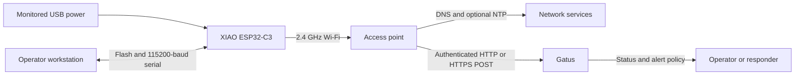

# ESP32 Power Check Concept of Operations

**Document status:** Operational baseline  
**System:** Seeed Studio XIAO ESP32-C3 power-availability monitor  
**Primary audience:** Operators and maintainers  
**Authoritative implementation:** [`src/main.cpp`](src/main.cpp)

## 1. Purpose and mission

ESP32 Power Check provides an unattended indication that power and enough of the
supporting network path remain available at a monitored location. A USB-powered
XIAO ESP32-C3 sends authenticated heartbeats to a Gatus external endpoint. Gatus
marks the endpoint unhealthy and applies its configured alert policy when the
heartbeats stop.

The device is a continuity indicator, not an electrical instrument. A missed
heartbeat can result from loss of power, Wi-Fi, DNS, routing, NTP (for HTTPS),
the Gatus service, or another dependency. It does not measure voltage, current,
energy use, power quality, or the cause of an outage.

Operational objectives are to:

- send a heartbeat immediately after boot and every 30 seconds thereafter;
- recover automatically from transient Wi-Fi, time, and Gatus failures;
- expose useful local diagnostics over USB serial;
- use an outbound-only network model with no device-hosted web server; and
- support verified HTTPS for deployments that cross an untrusted network.

## 2. Operational context

### Stakeholders and responsibilities

| Role | Responsibilities |
| --- | --- |
| System owner | Select the monitored location, define alerting expectations, approve HTTP or HTTPS use, and accept residual risk. |
| Installer | Provide stable USB power from the circuit being observed, provision firmware and secrets, configure the matching Gatus endpoint, and perform acceptance tests. |
| Operator | Watch Gatus status and alerts, correlate alarms with other evidence, and initiate incident response. |
| Maintainer | Diagnose serial logs, rotate credentials and CA material, update firmware/configuration, and revalidate after changes. |
| Network/Gatus administrator | Maintain 2.4 GHz access, DHCP, DNS, NTP reachability, routing, Gatus availability, endpoint tokens, and downstream alert delivery. |

### Environment and dependencies

The operating environment requires:

- continuous USB power associated with the location or circuit to be observed;
- a Seeed Studio XIAO ESP32-C3 running this firmware;
- at least one configured 2.4 GHz Wi-Fi network with DHCP and required routing;
- DNS when hostnames are used and NTP when verified HTTPS is used;
- a reachable Gatus deployment with a matching `external-endpoints` entry; and
- an alert provider configured in Gatus when active notifications are required.

The device supports one required and up to two optional Wi-Fi credential sets.
During normal selection, `WiFiMulti` chooses the strongest available configured
network. An ordered pass provides a fallback after repeated failures.

### Boundaries and exclusions

The system does not provide an access point, inbound API, web user interface,
local alarm annunciator, cellular failover, historical telemetry store, or
direct electrical sensing. Gatus owns health state, alert thresholds, alert
delivery, retention, and visualization. The firmware does not distinguish a
power interruption from a communications or service interruption by itself.

## 3. Interfaces

| Interface | Operational contract |
| --- | --- |
| Power and maintenance | USB powers the device and provides USB CDC for flashing and serial diagnostics. Serial speed is 115200 baud. |
| Wi-Fi | Station mode only on 2.4 GHz. Hostname is `xiao-power-monitor`; addressing is supplied by DHCP. |
| DNS | Resolves the configured Gatus and NTP hostnames through the network environment. |
| NTP | Defaults to `pool.ntp.org` and `time.cloudflare.com`; values may be overridden. A valid clock is required before verified HTTPS heartbeats. |
| Gatus | `POST <GATUS_BASE_URL>/api/v1/endpoints/<GATUS_ENDPOINT_KEY>/external?success=true` with `Authorization: Bearer <GATUS_TOKEN>`. No request body is required. HTTP status `200` is success. |
| TLS | For HTTPS, the base URL must use a DNS name matching the certificate SAN. The configured root CA validates the chain and hostname. |
| Alerting | Gatus evaluates heartbeat age and its configured alert policy. The example uses a 90-second heartbeat window, failure threshold 3, success threshold 2, and resolved notifications. |

The endpoint key must match the key derived by Gatus from the external endpoint's
group and name. Operators must use the generated key when spaces or punctuation
are normalized rather than assuming the displayed group and name are accepted
unchanged.

## 4. Operational concept

### Provisioning and deployment

1. Create the external endpoint in Gatus using
   [`gatus-config.example.yaml`](gatus-config.example.yaml) as a starting point.
2. Copy [`include/secrets.example.h`](include/secrets.example.h) to the ignored
   `include/secrets.h` file and enter Wi-Fi, Gatus URL, endpoint key, token, and
   HTTPS trust settings.
3. Build and flash the `seeed_xiao_esp32c3` PlatformIO environment.
4. Connect the device to USB power supplied by the location being monitored.
5. Open the 115200-baud serial monitor, reset the device, and complete the
   acceptance checks in Section 8.

### Boot and network acquisition

At boot, the firmware opens USB serial, increments a persistent boot counter,
reports the reset reason and configuration summary, configures Wi-Fi station
mode, registers valid configured networks, and attempts association. It logs
visible and selected network information to aid installation.

After association, the device logs SSID, local IP address, RSSI, channel, and
BSSID. It makes a best-effort NTP synchronization attempt. If HTTPS is selected,
an invalid clock gates heartbeat transmission until time becomes valid. Plain
HTTP does not require synchronized time.

### Heartbeat and steady-state operation

The first heartbeat is attempted immediately after startup prerequisites are
met. Further heartbeats are attempted every 30 seconds. Each request uses the
Gatus external endpoint URL and bearer token described in Section 3.

The serial log reports the heartbeat URL, HTTP response code, device uptime,
Wi-Fi RSSI, local IP address, and free heap. A response code of exactly `200`
clears the consecutive heartbeat-failure count. Any other HTTP response or a
transport-level error counts as a failure.

Gatus converts receipt or absence of these pushes into endpoint health. The
example 90-second Gatus heartbeat window is deliberately longer than the
30-second device cadence so one missed push does not immediately change health.

### Degraded operation and automatic recovery

```mermaid
stateDiagram-v2
    [*] --> Boot
    Boot --> JoiningWiFi
    JoiningWiFi --> Ready: associated
    JoiningWiFi --> JoiningWiFi: retry every 10 s
    JoiningWiFi --> Restart: 30 failed joins
    Ready --> WaitingForTime: HTTPS and clock invalid
    WaitingForTime --> WaitingForTime: NTP retry every 60 s
    WaitingForTime --> Reporting: clock valid
    Ready --> Reporting: HTTP or valid clock
    Reporting --> Reporting: HTTP 200; next push in 30 s
    Reporting --> Degraded: non-200 or transport failure
    Degraded --> Reporting: later HTTP 200
    Degraded --> Restart: 20 consecutive failures
    Ready --> JoiningWiFi: Wi-Fi lost
    Reporting --> JoiningWiFi: Wi-Fi lost
    Restart --> Boot
```

Implemented recovery parameters are:

| Condition | Behavior |
| --- | --- |
| Wi-Fi disconnected | Retry every 10 seconds. Each association attempt can run for up to 12 seconds. |
| Three failed reconnects | Add an ordered attempt across configured networks instead of relying only on strongest-network selection. |
| Thirty failed Wi-Fi attempts | Restart the ESP32; nominal elapsed time is about five minutes plus connection-attempt time. |
| Clock invalid | Retry NTP every 60 seconds. Boot synchronization waits up to 5 seconds; later synchronization attempts wait up to 15 seconds. |
| HTTPS with invalid clock | Defer the heartbeat without incrementing the heartbeat-failure count. |
| HTTP request | Allow up to 10 seconds for the HTTP read operation. HTTPS connection setup allows up to 15 seconds. |
| Non-200 response or request failure | Increment the consecutive heartbeat-failure count. A later `200` clears it. |
| Twenty consecutive heartbeat failures | Restart the ESP32; at the nominal cadence this is about ten minutes, excluding request duration. |

The persistent boot count and logged reset reason help distinguish observed power
cycles from firmware-initiated recovery. Neither is a definitive root-cause
record; operators must correlate it with Gatus, network, and facility evidence.

### Maintenance and retirement

Maintenance is required when credentials or CA roots change, Wi-Fi coverage or
names change, Gatus is moved, repeated restart cycles occur, serial diagnostics
show resource or TLS errors, or firmware dependencies are updated. After any
material change, repeat the acceptance tests.

For retirement, disable or remove the Gatus external endpoint and its alerts,
disconnect the device, revoke or rotate its Gatus token, remove stored Wi-Fi
credentials according to local policy, and update the asset record. Removing
the device before disabling alerting will intentionally produce a missing-
heartbeat condition.

## 5. Observability and operator response

### Expected serial evidence

Operators should expect diagnostic lines containing these prefixes:

- startup banner, `boot_count`, and `reset_reason`;
- `[wifi]` for scans, registered networks, association details, disconnection,
  reconnect streaks, and ordered attempts;
- `[ntp]` for DNS resolution and time synchronization;
- `[tls]` for missing trust material, insecure-mode warnings, and handshake
  failures; and
- `[gatus]` for the target URL, HTTP status, uptime, RSSI, IP address, and heap.

Serial output is diagnostic and is not forwarded to Gatus. Routine remote
operation relies on the Gatus endpoint state and downstream alerts.

### Fault scenarios

| Observation | Likely causes | Operator action |
| --- | --- | --- |
| No serial startup output | No USB power, wrong port, cable problem, device fault, or incorrect monitor settings | Confirm power/cable/port and 115200 baud; reset and reflash if required. |
| Repeated Wi-Fi failures | Wrong credentials, 5 GHz-only network, weak signal, DHCP failure, or access policy | Check `[wifi]` scan and association logs; verify 2.4 GHz coverage and credentials. |
| HTTPS heartbeats deferred | NTP/DNS unavailable or clock never becomes valid | Restore DNS/NTP reachability and inspect `[ntp]` output. Do not bypass validation in production. |
| TLS handshake error | CA mismatch, hostname mismatch, expired certificate, invalid time, or routing issue | Verify URL hostname, certificate SAN/chain, root CA, time, and reachability. |
| HTTP 401/403 | Token mismatch or endpoint authorization problem | Match `GATUS_TOKEN` with the server endpoint token and rotate if exposure is suspected. |
| HTTP 404 | Wrong base URL or endpoint key | Compare the configured key with Gatus's derived external-endpoint key. |
| Gatus unhealthy but device reports `200` | Gatus endpoint identity mismatch, health-window/configuration issue, or alert pipeline problem | Confirm the displayed endpoint, Gatus configuration, timestamps, and alert provider. |
| Repeated automatic resets | Sustained Wi-Fi or Gatus failure, or another reset cause | Use boot count and reset reason, then correlate with network and server logs. |

An alert indicates loss of end-to-end heartbeat continuity. Responders should
first determine whether the location lost power, then check Wi-Fi/network and
Gatus health before attributing the alarm to a device fault.

## 6. Security concept

- `include/secrets.h` contains Wi-Fi passwords, the Gatus token, and possibly a
  private trust root. It is ignored by Git and must not be committed, printed in
  tickets, or copied into this document.
- Use HTTPS with a configured `GATUS_ROOT_CA` when traffic crosses an untrusted
  network. Certificate-chain and hostname validation are expected in production.
- `GATUS_ALLOW_INSECURE_TLS` disables certificate validation and is an explicit
  testing-only escape hatch. Its serial warning must never be accepted as a
  normal production state.
- With HTTPS, a DNS hostname matching the certificate SAN is required; a bare IP
  address generally cannot satisfy hostname verification.
- The device initiates outbound Wi-Fi, DNS, NTP, and Gatus traffic only. It does
  not intentionally expose an inbound web service.
- Rotate the Gatus token after suspected disclosure and whenever local credential
  lifecycle policy requires it. Rebuild, reflash, and revalidate the device.
- Physical access to the device and its USB interface must be controlled because
  firmware and local diagnostics may reveal operational configuration.

## 7. Operational assumptions and risks

- The monitored USB supply fails when the power condition of interest fails.
  UPS-backed power or a different circuit can invalidate the intended signal.
- Gatus and its alert delivery path remain powered and reachable independently
  enough to report loss of the monitored device.
- Network maintenance can produce the same symptom as loss of monitored power.
- The device has no independent clock or store-and-forward channel; outages are
  inferred from missing heartbeats rather than reported after the fact.
- The configured Gatus heartbeat window and alert thresholds determine detection
  and notification latency. The example favors avoiding alerts on one missed push.
- Automatic restart improves recovery but can erase volatile diagnostic context;
  the persistent boot counter and reset reason provide only limited continuity.

## 8. Acceptance criteria

The installation is operationally accepted when all applicable checks pass:

1. A clean build completes for the `seeed_xiao_esp32c3` PlatformIO environment.
2. Startup serial output identifies the device, reset reason, persistent boot
   count, 30-second heartbeat interval, and HTTP/HTTPS mode.
3. The device associates with an approved 2.4 GHz SSID and logs a valid DHCP
   address and plausible RSSI.
4. For HTTPS, NTP establishes a valid clock and the TLS session validates using
   the configured CA and hostname, with no insecure-TLS warning.
5. The initial Gatus request returns HTTP `200`, and subsequent `200` responses
   occur at the nominal 30-second cadence.
6. The corresponding Gatus external endpoint is healthy and receives pushes
   under the intended group/name-derived key.
7. Temporarily removing Wi-Fi causes retry evidence at the designed cadence;
   restoring Wi-Fi allows recovery without manual reset.
8. Suspending heartbeats long enough to exceed the Gatus policy produces the
   intended alert, and restoration produces the configured recovery indication.
9. Serial logs contain no Wi-Fi password, bearer token, or private CA material.
10. `include/secrets.h` remains untracked and no production secret appears in
    committed files.

## 9. Configuration baseline and precedence

This document describes the behavior implemented at the time of review. If it
conflicts with executable behavior, [`src/main.cpp`](src/main.cpp) and the
deployed Gatus configuration determine actual operation. The following project
files support deployment and must be kept consistent with this CONOPS:

- [`README.md`](README.md) — build, deployment, verification, and troubleshooting;
- [`include/secrets.example.h`](include/secrets.example.h) — device configuration contract;
- [`gatus-config.example.yaml`](gatus-config.example.yaml) — server-side example; and
- [`platformio.ini`](platformio.ini) — board, framework, upload, and serial settings.
